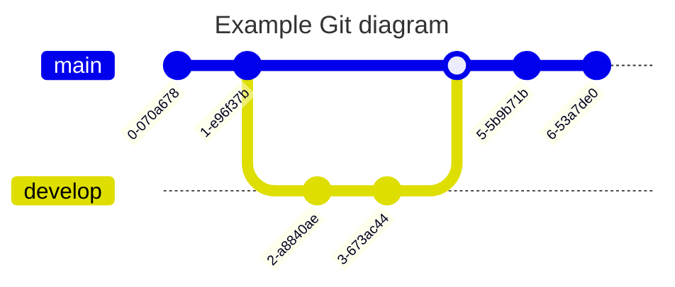

# Mi gran proyecto de desarrollo


basado en mi java:

```java
class Animal {
    String name;
    int age;

    void displayInfo() {
        System.out.println("Name: " + name);
        System.out.println("Age: " + age);
    }
}

public class Main {
    public static void main(String[] args) {
        Animal dog = new Animal();
        dog.name = "Buddy";
        dog.age = 5;
        dog.displayInfo();
    }
}
```



